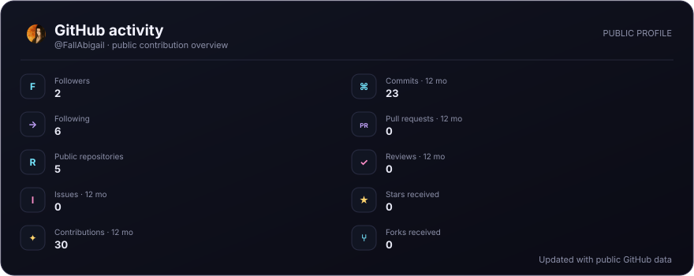

<!-- Generated from the public GitHub API by scripts/update-profile.mjs. -->

<h2 align="center">Make something cool</h2>

<a href="https://github.com/FallAbigail">GitHub</a>

<a href="https://github.com/FallAbigail?tab=repositories">Explore all repositories →</a>

