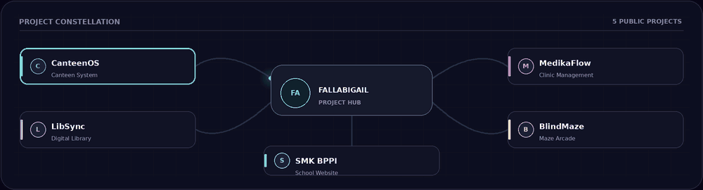
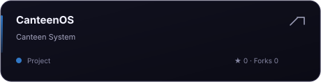
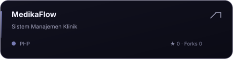
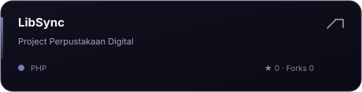
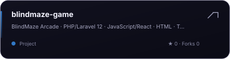
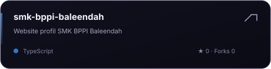
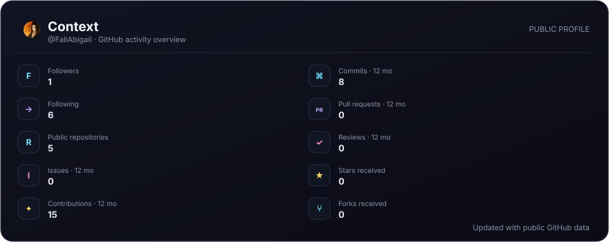

<!-- Generated from the public GitHub API by scripts/update-profile.mjs. -->

<h2 align="center">Featured projects</h2>
<table align="center" border="0"><tbody><tr><td align="center"></td><td align="center"></td></tr><tr><td align="center"></td><td align="center"></td></tr><tr><td colspan="2" align="center"></td></tr></tbody></table>

<h2 align="center">Make something cool</h2>
